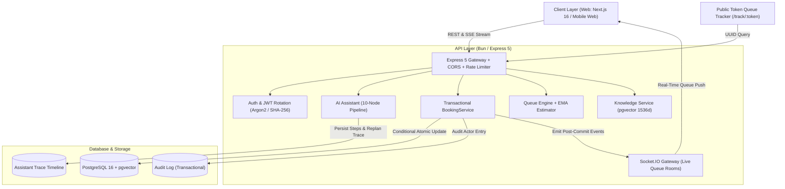

# ClinicQ — AI-Assisted Clinic Appointment & Queue Platform

ClinicQ is an intelligent, multi-tenant healthcare appointment platform that bridges the gap between patients, receptionists, and doctors. A patient describes symptoms in their own words (English, Bangla, or mixed Banglish); an AI booking assistant clarifies constraints, routes to the correct specialty, detects emergencies, and books guaranteed conflict-free slots. On appointment day, an adaptive live queue provides transparent wait-time estimations, while doctors receive structured clinical context before consultations begin.

---

## 1. Problem Statement

Small and mid-size clinics suffer from chronic operational inefficiencies:
- **Wrong-Specialist Bookings:** Patients often do not know which specialist they require, leading to misallocated appointments or repeated calls to reception.
- **Queue Chaos & Double-Booking:** Phone and walk-in scheduling create accidental overlaps, unpredictable delays, and frustrated patients waiting without status updates.
- **Cold Consultations:** Doctors consult patients with zero pre-visit context; urgent clinical cases wait in the same linear queue as routine checks.
- **Reception Burnout:** Clinic staff spend hours answering repetitive inquiries (timings, consultation fees, doctor availability) rather than attending to patients.

**ClinicQ solves this end-to-end** through transactional conversational booking, atomic double-booking prevention, real-time Socket.IO queue tracking with Exponential Moving Average (EMA) wait estimates, and clinic knowledge retrieval (RAG).

---

## 2. Architecture Diagram



---

## 3. Database Design & Entity Relationships

The database is built on PostgreSQL with the `pgvector` extension and managed via Prisma ORM:

- **`Clinic`**: Multi-tenant isolation anchor. All users, doctors, schedules, appointments, and knowledge belong to a `clinicId`.
- **`User`**: Authentication identity with role-based access (`ADMIN`, `DOCTOR`, `RECEPTIONIST`, `PATIENT`), storing Argon2 hashes and refresh token hashes.
- **`DoctorProfile` & `DoctorSchedule`**: Doctor specialty, bio, consultation fee, average consult duration, and weekly availability rules.
- **`Slot`**: Individual appointment windows generated by schedule rules with strict state management (`AVAILABLE`, `BOOKED`, `BLOCKED`). Unique composite key on `[doctorId, startsAt]`.
- **`Appointment`**: The transactional booking record linking patient, slot, status (`BOOKED`, `CHECKED_IN`, `IN_CONSULTATION`, `COMPLETED`, `CANCELLED`, `NO_SHOW`), channel (`MANUAL`, `ASSISTANT`, `RECEPTION`), triage summary, urgency level, and unique public `trackingToken`.
- **`WaitlistEntry`**: Patient waitlist entries promoted automatically when an earlier slot is cancelled or rescheduled.
- **`KnowledgeDoc` & `KnowledgeChunk`**: Clinic content chunked and indexed with 1536-dimensional vector embeddings for cosine similarity retrieval.
- **`AssistantTrace`**: Complete multi-turn timeline of every assistant execution (inputs, tool calls, replan attempts, and final outcome) for explainability and auditing.
- **`AuditLog`**: Immutable audit records written in the same database transaction for all state transitions and bookings.

---

## 4. Demo Credentials (Dhaka Central Clinic)

Pre-seeded credentials for immediate local evaluation:

| Role | Email | Password | Details |
|---|---|---|---|
| **Admin** | `admin@clinicq.local` | `Password123!` | Clinic management, metrics, audit logs |
| **Receptionist** | `reception@clinicq.local` | `Password123!` | Queue operations, walk-in check-in |
| **Doctor (Cardiology)** | `dr.rahim@clinicq.local` | `Password123!` | Dr. Rahim — Senior Consultant Cardiologist (৳1,200) |
| **Doctor (Pediatrics)** | `dr.fatima@clinicq.local` | `Password123!` | Dr. Fatima — Specialist Pediatrician (৳1,000) |
| **Doctor (General Medicine)** | `dr.karim@clinicq.local` | `Password123!` | Dr. Karim — General Physician (৳800) |
| **Patient 1** | `patient.tanvir@clinicq.local` | `Password123!` | Tanvir Ahmed — Registered Patient |
| **Patient 2** | `patient.nusrat@clinicq.local` | `Password123!` | Nusrat Jahan — Registered Patient |

---

## 5. Key APIs

### Authentication & Public Directory
- `POST /api/auth/register` — Register new patient account
- `POST /api/auth/login` — Login, issue access token & rotated refresh token
- `POST /api/auth/refresh-token` — Rotate refresh token using SHA-256 database verification
- `GET /api/public/clinics/:clinicId/doctors` — Search public doctor directory
- `GET /api/public/doctors/:id/slots` — Browse available appointment slots
- `GET /api/public/track/:token` — Unauthenticated public live queue tracking page

### Appointments & Queue
- `POST /api/appointments/book` — Transactional booking with double-booking prevention (`Idempotency-Key` supported)
- `PATCH /api/appointments/:id/transition` — Validated status lifecycle transition
- `POST /api/appointments/:id/reschedule` — Reschedule booking, re-opening original slot
- `POST /api/appointments/:id/cancel` — Cancel booking, auto-promoting waitlist patients
- `GET /api/queue/doctor/:doctorId` — Real-time queue list with EMA wait estimates
- `GET /api/queue/clinic` — Clinic-wide reception overview

### AI Booking Assistant & Knowledge
- `POST /api/assistant/chat` — Streaming (SSE) conversational assistant pipeline
- `GET /api/assistant/traces` — Paginated admin audit trace timeline
- `POST /api/knowledge/search` — Tenant-scoped RAG search citing document titles
- `GET /api/admin/metrics` — Operational dashboard metrics (wait times, utilization, channels)
- `GET /api/admin/audit-logs` — Immutable audit trail with actor filters

---

## 6. AI Booking Assistant Design

The AI Booking Assistant runs as a deterministic 10-node agentic graph with an OpenAI-compatible LLM client and an offline test client fallback:

```
[User Message] ──> 1. safetyCheck (Red-flag triage) ──[Emergency Detected]──> Emit Urgent ER Alert & Halt
                         │
                         ▼
                   2. understand (Extract symptoms, hard constraints & soft wishes)
                         │
                         ▼
                   3. clarify (Targeted follow-up if ambiguous, max 4 turns)
                         │
                         ▼
                   4. route (Map to clinic specialty & urgency level)
                         │
                         ▼
                   5. search (Query doctor profiles & real-time slots)
                         │
            ┌────────────┴─────────────┐
       [Matches Found]          [Zero Matches]
            │                          │
            ▼                          ▼
       7. propose               6. replan (Soft relaxation: time of day -> days)
            │                   (Hard constraints NEVER relaxed without patient consent)
            │                   (Strict code-level cap: max 3 attempts)
            ▼                          │
       8. confirm <────────────────────┘
            │
      [Explicit Yes]
            │
            ▼
       9. act (Transactional call to BookingService with Idempotency Key)
            │
            ▼
       10. finish (Confirmed booking details, checklist & tracking token)
```

---

## 7. Assistant Evaluation Suite & Results

The system includes a 26-scenario evaluation suite (`bun run eval:assistant`) executing against a live seeded PostgreSQL database.

### Evaluation Metrics Summary

```
================================================================================
  EVALUATION RESULTS SUMMARY (26 Scenarios)
================================================================================
Total Scenarios Evaluated:         26
Passed Scenarios:                  26
Failed Scenarios:                  0
Overall Evaluation Pass Rate:      100%

Core Requirements:
• Tool & Search Constraint Correctness:  100%
• Replan Limit Adherence (Max 3 turns):  100%
• Hard-Constraint Consent Violations:    0 (Strict 0 requirement met)
• Emergency Red Flag Detection:          100% (Strict 100% requirement met)
• Specialty Routing Accuracy:            100%
• Tenant Isolation Security:             0 Violations (Strict 0 requirement met)
• Idempotency Safety (Replay check):     100%
• Provider Outage Resiliency:            100%
• Average Conversation Turns to Booking: 2.5 turns
================================================================================
```

### Scripted Scenarios Evaluated
1. **Clear Cardiology** — Palpitations and hypertension routed accurately.
2. **Clear Pediatrics** — Infant wellness and fever routed to Pediatrics.
3. **Emergency Chest Pain (EN)** — Crushing pain redirected to ER immediately.
4. **Emergency Chest Pain (BN)** — Bangla red-flag keywords trigger urgent care alert.
5. **Emergency Stroke Signs** — Slurred speech and facial droop halt booking for ER.
6. **Emergency Severe Bleeding** — Uncontrolled hemorrhage triggers urgent alert.
7. **Vague Symptoms** — Fatigue safely routed without emergency false alarms.
8. **Mixed Banglish (Cardio)** — Bengali-English code-switching handled cleanly.
9. **Mixed Banglish (Pediatric)** — Child cough in Banglish routed to Pediatrics.
10. **Hard Constraint: Budget** — Doctor fee cap respected; stops without booking if above budget.
11. **Hard Constraint: Gender** — Female doctor preference strictly honored.
12. **Hard Constraint: Gender + Budget** — Simultaneous hard constraints maintained.
13. **Soft Relaxation** — Morning preference widened to afternoon when unavailable.
14. **Replan Limit (Max 3)** — Stops after 3 failed attempts, offering waitlist.
15. **Consent Safety: Refusal** — Patient refusal of higher fee prevents booking.
16. **Consent Safety: Approval** — Higher fee booked only after explicit patient consent.
17. **Clinic Info: Timings** — RAG retrieves clinic operating hours with citations.
18. **Clinic Info: Fees** — RAG answers general consultation fee policies.
19. **Clinic Info: Unknown** — RAG returns graceful "I do not have that information".
20. **Booking Confirmation** — Explicit "Yes" executes transactional booking.
21. **Race Condition** — Graceful handling when slot is taken mid-conversation.
22. **Reschedule Request** — Reschedule intent detected and executed.
23. **Cancel Request** — Cancellation intent detected and executed.
24. **Tenant Isolation** — Cross-clinic access requests blocked.
25. **Idempotency** — Replaying booking turn returns original appointment.
26. **Provider Outage** — LLM timeout emits clear error event with manual calendar fallback.

---

## 8. Adaptive Wait Estimator (EMA)

Wait times are not static guesses. The live queue uses an Exponential Moving Average ($\alpha = 0.3$) based on that specific doctor's real historical consultation durations:

$$\text{EMA}_t = (\alpha \times \text{Duration}_t) + ((1 - \alpha) \times \text{EMA}_{t-1})$$

$$\text{Estimated Wait (minutes)} = \text{Ahead Count} \times \text{Doctor's Adaptive EMA Duration}$$

- Minimum floor of 5 minutes per consultation prevents unrealistic zero-wait estimates.
- Durations $> 180$ minutes or negative values are filtered as non-representative outliers.
- Updates broadcast via Socket.IO room `doctor:{doctorId}` after every consultation finish.

---

## 9. Concurrency & Double-Booking Prevention

Double-booking is prevented at the database engine level via an atomic conditional update inside an interactive transaction:

```typescript
const updateResult = await tx.slot.updateMany({
  where: {
    id: slotId,
    status: SlotStatus.AVAILABLE, // Atomic check
  },
  data: {
    status: SlotStatus.BOOKED,
  },
});

if (updateResult.count === 0) {
  throw new AppError(409, "Slot is no longer available. Please select another slot.");
}
```

Simultaneous concurrent booking requests result in exactly one successful booking (HTTP 201) and one conflict (HTTP 409). Verified by automated concurrency tests (`apps/api/src/app/modules/appointment/__tests__/concurrency.test.ts`).

---

## 10. Local Development Setup

### Prerequisites
- [Bun](https://bun.sh) (v1.2+)
- [Docker](https://docker.com) (for local PostgreSQL 16 + pgvector)

### Steps

1. **Clone the repository:**
   ```bash
   git clone <repo-url>
   cd ClinicQ
   ```

2. **Start PostgreSQL with pgvector:**
   ```bash
   docker compose up -d
   ```

3. **Install dependencies:**
   ```bash
   bun install
   ```

4. **Initialize Database & Seed Demo Data:**
   ```bash
   cd apps/api
   bunx prisma db push
   bun run db:seed
   ```

5. **Run Test Suites & Evaluations:**
   ```bash
   # Run all 86 unit and integration tests
   bun test

   # Run 26-scenario Assistant Evaluation Suite
   bun run eval:assistant
   ```

6. **Start Development Server:**
   ```bash
   # From root:
   bun run dev:api
   ```
   API will be live at `http://localhost:4000`, with health check at `http://localhost:4000/health`.

---

## 11. Deployment Configuration

- **Web Frontend:** Deploy to [Vercel](https://vercel.com) (root directory: `apps/web`).
- **Backend API:** Deploy to [Render](https://render.com) or [Railway](https://railway.app) using the provided `apps/api/Dockerfile` (supports persistent WebSocket connections).
- **Database:** Deploy on [Neon](https://neon.tech) (PostgreSQL 16 with native `pgvector` extension support).

---

## 12. Known Limitations & Next Steps

1. **SMS/WhatsApp Integration:** Currently, notifications and tracking links are delivered via in-app Socket.IO and web responses. Next step: integrate Twilio/Infobip for direct SMS dispatch upon booking.
2. **Payment Gateway Integration:** Consultation fees are currently tracked as clinic payable amounts. Next step: integrate bKash / SSLCommerz / Stripe for online prepayment.
3. **Voice Audio Assistant:** The assistant currently supports text and transliterated Banglish. Next step: integrate Whisper / Gemini Live Audio for direct phone-call booking automation.
